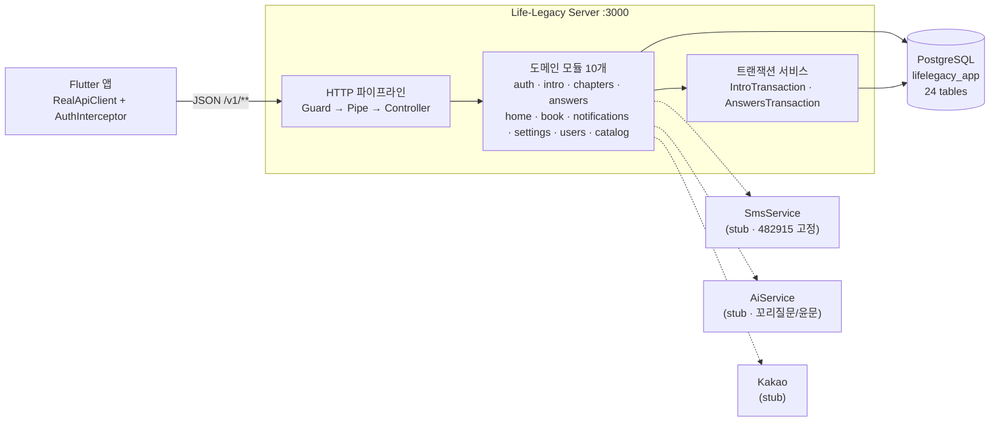
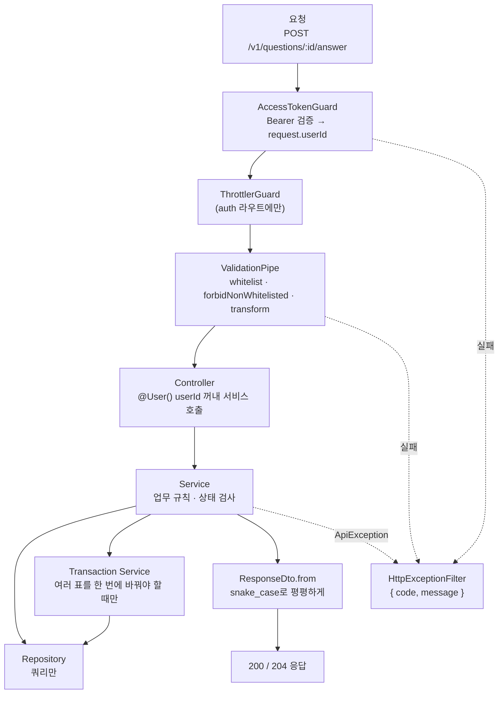
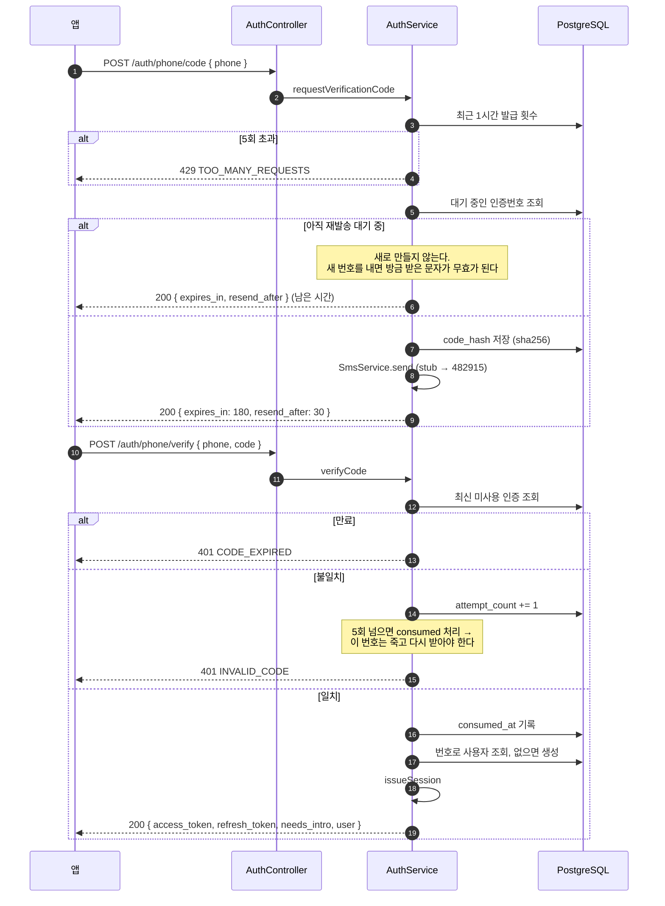
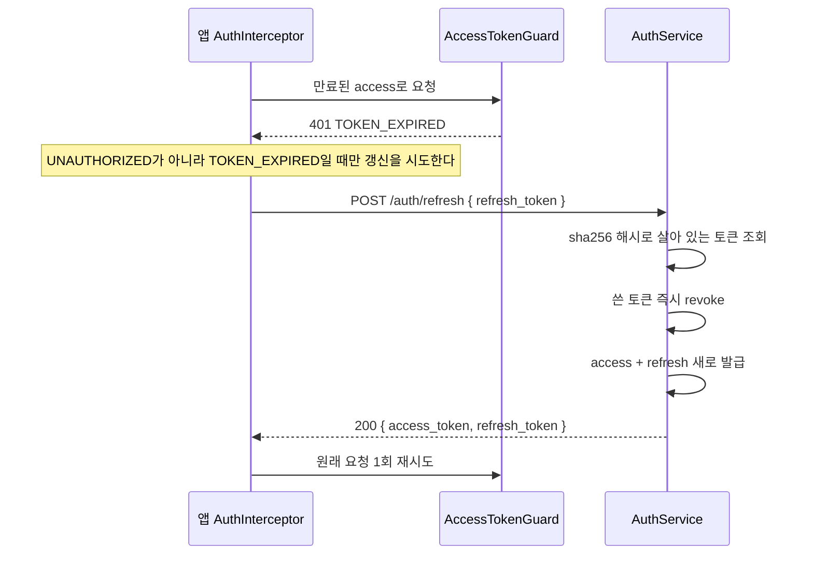
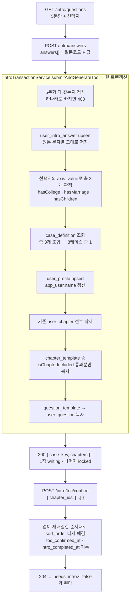
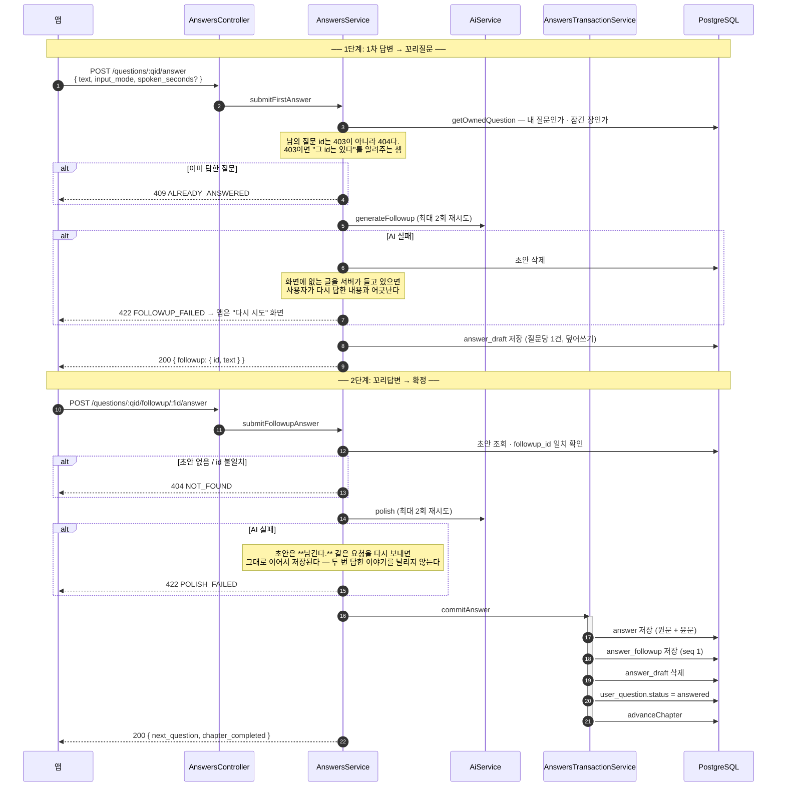
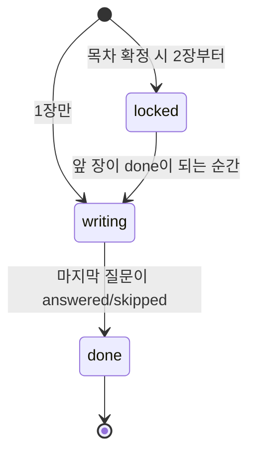
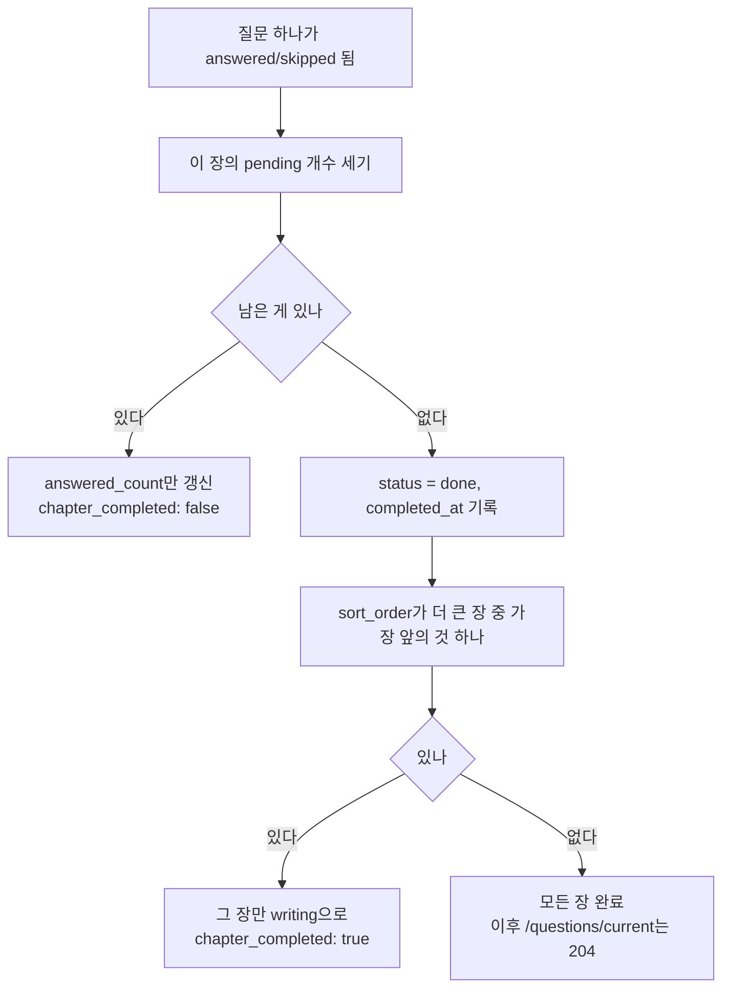
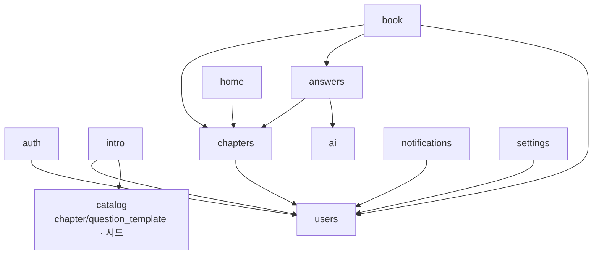
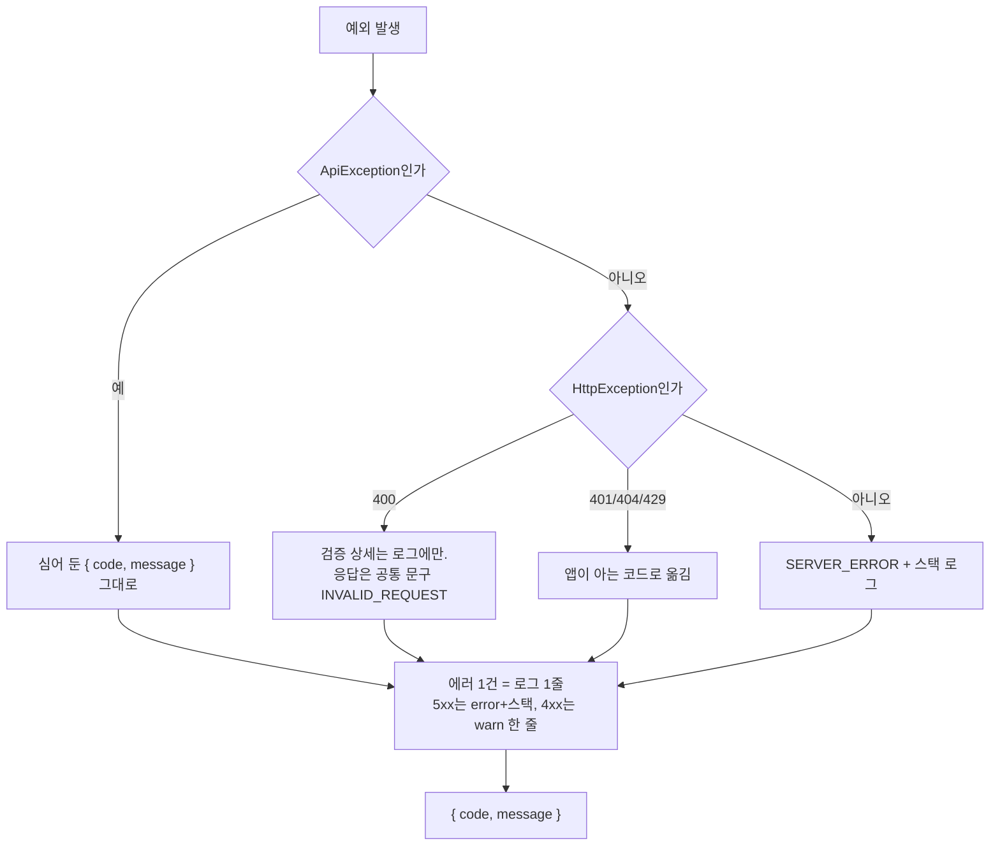

# Life-Legacy Server — 동작 구조와 플로우

`server/` 디렉터리의 NestJS 서버가 **실제로 어떻게 도는지** 정리한 문서다.
계약 자체는 [api-spec.md](api-spec.md), 표 구조는 [../erd/new-erd.dbml](../erd/new-erd.dbml)에 있고,
여기서는 **요청이 들어와서 나갈 때까지 무슨 일이 일어나는지**를 다룬다.

- 런타임: Node 24 / NestJS 11 / TypeORM 0.3 / PostgreSQL
- 전역 프리픽스: `/v1` (단 `/health`는 제외)
- 응답: **래퍼 없음**. 단건은 리소스 그대로, 목록은 `{ items: [...] }`
- 실패: `{ code, message }` — `message`는 앱이 토스트에 **그대로 띄우는 한국어 문장**

---

## 1. 전체 구성



**스텁 3개**(SMS·AI·카카오)는 전부 `isStub` 게터를 갖고 있고, 환경변수
(`SMS_PROVIDER` / `AI_PROVIDER` / `KAKAO_PROVIDER`)가 `stub`이 아니면 **던진다.**
"조용히 가짜 값을 돌려주는" 상태로 운영에 올라가지 않게 하려는 것이다.
제공자가 정해지면 이 세 클래스만 갈아 끼우면 되고, 호출하는 쪽은 손대지 않는다.

---

## 2. 요청 한 건이 지나가는 길



### 각 칸이 하는 일

| 칸 | 책임 | 안 하는 일 |
|---|---|---|
| **Guard** | 토큰 검증, `request.userId` 심기 | 권한 판정(내 것인지)은 서비스가 한다 |
| **Pipe** | DTO 모양·타입 검증 | 업무 규칙 검사 |
| **Controller** | 라우팅, `@User()`로 userId 꺼내기, 상태코드 | 로직 |
| **Service** | 상태 검사, 실패 분기, AI 호출 | 직접 쿼리 |
| **Transaction** | 여러 표를 원자적으로 바꾸기 | 단건 조회 |
| **Repository** | 쿼리 | 판단 |
| **DTO** | 앱 계약 모양으로 변환 | — |

**`ResponseInterceptor`를 일부러 두지 않았다.** 표준 구조(`project-conventions.md` §5.3)는
`{statusCode, message, data}`로 한 겹 더 감싸지만, 앱의 `ApiException`이 최상위
`code`·`message`를 읽도록 이미 구현·테스트돼 있어서 **앱 계약을 택했다.**
이 결정은 `main.ts`와 `HttpExceptionFilter`에 주석으로 남아 있다.

---

## 3. 인증 — 가입과 로그인을 구분하지 않는다



- **`needs_intro`가 앱 분기의 유일한 근거다.** `intro_completed_at`이 null이면 true.
  목차 확정까지 끝나야 false가 된다.
- 앱은 이 값을 받아 `Storage.markIntroDone()`을 맞춘다 — 앱을 지웠다 깔아도
  자기소개를 처음부터 다시 하지 않는다.

### 토큰 회전



- **리프레시도 회전시킨다.** 한 번 쓴 토큰이 계속 유효하면 새어 나갔을 때
  60일 만료를 기다리는 수밖에 없다.
- 리프레시 JWT payload에 **`jti: randomUUID()`가 들어간다.** 이게 없으면 같은 초에
  두 번 발급했을 때 `sub·iat·exp`가 같아 **토큰 문자열까지 동일**해지고,
  `token_hash` 유니크에 걸려 갱신이 500으로 죽는다 (실제로 겪고 고친 버그, 회귀 spec 있음).
- 앱 쪽은 갱신을 `Future<bool>?` 하나로 묶어 **동시 401이 여러 번 갱신을 쏘지 않게** 한다.

---

## 4. 자기소개 → 케이스 판정 → 목차

서비스의 핵심이자, 가장 많은 규칙이 모인 곳이다.



### 케이스 8종

축 3개는 **서로 독립**이라 2×2×2 = 8이다.

| 축 | 판정 문항 | true 조건 |
|---|---|---|
| `hasCollege` | i5 학력 | **대학교 이상**만 true |
| `hasMarriage` | i3 결혼 | 했어요 |
| `hasChildren` | i4 자녀 | 있어요 |

목차 10장 중 **3장이 조건부**(대학생활 / 결혼 이야기 / 자녀 이야기)이고,
나머지 7장은 항상 들어간다. 그래서 장 수는 케이스에 따라 7~10장이 된다.

**케이스 판정은 `src/intro/const/case-axes.ts`의 `isChapterIncluded()` 한 함수에만 있다.**
대주제를 추가하더라도 손댈 곳은 여기 하나다.

### 이 트랜잭션이 하나여야 하는 이유

답변만 저장되고 목차가 안 만들어지면, 사용자는 **자기소개를 다시 할 수도 없고
목차를 받을 수도 없는 상태에 갇힌다.** `user_profile`은 있는데 `user_chapter`가
비어 있으면 어느 화면으로도 진행이 안 된다.

### 목차 확정에 숨은 함정

`user_chapter`에 `(user_id, sort_order)` 유니크가 걸려 있어서, 재배열한 순서를
곧바로 1..N으로 쓰면 **중간에 충돌한다.** 그래서 **두 번에 나눠 쓴다** — 먼저 전부
음수(-1, -2, …)로 밀어 두고, 그다음 1..N을 쓴다.

---

## 5. 작성 흐름 — 저장이 2단계인 이유

**한 질문 = 1차 답변 + 꼬리답변 한 쌍**이다. 1차 답변만으로는 아무것도 확정하지 않는다.



### 두 실패의 처리가 다른 이유

| 실패 | 초안 | 사용자가 할 일 | 코드 |
|---|---|---|---|
| **꼬리질문 생성 실패** | **지운다** | 처음부터 다시 답한다 | `FOLLOWUP_FAILED` |
| **윤문 실패** | **남긴다** | 저장만 다시 누른다 | `POLISH_FAILED` |

1단계에서 초안을 남겨 두면, 사용자가 화면에서 다시 답했을 때 서버가 들고 있던
**옛 답변**이 살아나 어긋난다. 반대로 2단계는 사용자가 이미 **두 번 답했다** —
여기서 초안을 지우면 그 이야기를 통째로 날리는 것이다. 이 두 규칙은 각각 spec으로 잠겨 있다.

### 저장되는 것

```
answer.first_text            ← 사용자가 1차로 답한 원문 (앱이 다시 볼 때 보여주는 값)
answer.polished_text         ← AI 윤문 결과 (자서전에 실리는 값)
answer.first_input_mode      ← voice | keyboard
answer.first_spoken_seconds  ← voice일 때만. keyboard면 NULL
answer_followup.answer_text  ← 꼬리답변 원문
```

앱은 **`input_mode`가 keyboard면 `spoken_seconds` 키 자체를 뺀다.** 0을 보내면
"0초 말했다"로 읽히기 때문이다. 이 규칙은 앱의 계약 테스트로도 잠겨 있다.

---

## 6. 장 진행과 순차 잠금



`advanceChapter()`가 매 저장마다 도는 로직:



**저장과 장 이동이 같은 트랜잭션이어야 하는 이유:** 답변만 저장되고 진행이 안 옮겨지면
같은 질문이 계속 "지금 답할 질문"으로 나온다. 사용자 눈에는 **저장이 안 된 것으로 보인다.**

`GET /questions/current`는 `writing` 장의 첫 `pending` 질문을 돌려주고,
없으면 **204 No Content**다. 앱은 이걸 "다 끝났다"로 읽고 자서전 화면으로 간다 —
예외로 다루면 완성 화면 대신 오류가 뜬다.

---

## 7. 자서전 조립


- **쪽 나누기는 서버가 정한다.** 앱은 받은 대로 그린다 — 기기 폭에 따라 쪽이
  달라지면 "12 / 34쪽"이 사람마다 달라진다.
- **매 요청마다 새로 계산한다.** 장이 끝날 때 `book_page`에 캐시하는 쪽이 빠르지만,
  캐시가 어긋났을 때 사용자가 보는 건 "내 이야기가 사라졌다"이다.
  v1은 정확성을 택했고, 느려지면 그때 캐시한다.
- 아직 `done`이 아닌 장은 **한 글자도 실리지 않는다.**

---

## 8. 모듈 의존 관계



- **`chapters`가 허브다.** 진행 상태를 아는 유일한 모듈이라 home·book·answers가 전부 여길 본다.
- **`AuthGuardModule`은 `AccessTokenGuard`와 `JwtModule`을 함께 export한다.**
  가드만 내보내면 이걸 쓰는 모듈에서 `JwtService`를 못 찾아 부팅이 죽는다 (실제로 겪음).
- **`catalog`는 아무것도 참조하지 않는다.** 질문 원본과 시드만 들고 있는 읽기 전용 모듈이다.

---

## 9. 에러 처리 규약



- **ValidationPipe의 상세 메시지를 그대로 내보내지 않는다.** 개발자용 영문 배열이라
  시니어 사용자에게 띄울 문장이 아니다. 상세는 로그에만 남기고 응답은 공통 문구로 바꾼다.
- `message`는 전부 **완성된 한국어 문장**이다 (`error-code.const.ts`).
  앱은 이걸 가공하지 않고 토스트에 그대로 띄운다.

---

## 10. 데이터 모델 24표 — 역할별 묶음

| 묶음 | 표 | 성격 |
|---|---|---|
| **원본 카탈로그** | `chapter_template` `question_template` `intro_question` `intro_choice` `case_definition` `prompt_template` | 시드로 채우는 **읽기 전용**. 사용자마다 복사돼 나간다 |
| **사용자** | `app_user` `user_profile` `social_account` `user_setting` `device_push_token` `shipping_address` | |
| **인증** | `phone_verification` `refresh_token` | 비밀은 전부 **sha256 해시로만** 저장 |
| **자기소개** | `user_intro_answer` | 원본 문자열 그대로. 판정용으로 접지 않는다 |
| **진행** | `user_chapter` `user_question` | 템플릿에서 복사된 **사용자 소유 사본** |
| **작성** | `answer` `answer_followup` `answer_draft` | `draft`는 확정되면 사라진다 |
| **산출** | `book` `book_page` | v1은 매번 계산. 캐시 자리만 잡아 뒀다 |
| **부가** | `notification` `ai_generation_log` | |

**템플릿을 참조가 아니라 복사하는 이유:** 사용자가 질문 문구를 고칠 수 있고
(`PATCH /questions/:id`), 원본이 개정돼도 **이미 답한 사람의 질문이 바뀌면 안 되기** 때문이다.
`user_question.text`가 그 사람이 실제로 본 문장이고, `answer.question_text`에
답변 시점의 문구를 한 번 더 박제한다.

---

## 11. 시드

```bash
npm run seed   # 몇 번을 돌려도 같다 (idempotent)
```

| 시드 | 내용 |
|---|---|
| `catalog.seed.ts` | 10장 · 질문 52개 — PDF 원문 그대로 |
| `case.seed.ts` | 케이스 8종 |
| `intro-question.seed.ts` | 자기소개 5문항 + 선택지, 축 매핑 |
| `prompt.seed.ts` | 꼬리질문·윤문 프롬프트 2건 |

**프롬프트는 코드가 아니라 표에 있다.** 문구를 고치는 데 배포가 필요 없어야 한다.

---

## 12. 지금 스텁인 것 / 남은 일

| 항목 | 현재 | 붙일 때 손댈 곳 |
|---|---|---|
| SMS | 인증번호 `482915` 고정 | `SmsService` 한 클래스 |
| AI | 고정 문구 + 원문 이어붙이기 | `AiService` 한 클래스 (프롬프트는 이미 DB) |
| 카카오 | 토큰 검증 없이 계정 생성 | `AuthService.loginWithKakao` |
| 스키마 | `DB_SYNCHRONIZE`로 생성 | 운영 전 `false` + DDL 수동 적용 |
| 비밀 | `.env` | SSM/시크릿 매니저 |
| 사진 | 없음 | 2차 범위 |

---

## 부록 — 라우트 전체

| 메서드 | 경로 | 인증 | 비고 |
|---|---|---|---|
| GET | `/health` | — | 프리픽스 제외 |
| POST | `/v1/auth/phone/code` | — | 레이트리밋 |
| POST | `/v1/auth/phone/verify` | — | 레이트리밋 · 없으면 가입 |
| POST | `/v1/auth/kakao` | — | stub |
| POST | `/v1/auth/refresh` | — | 회전 |
| POST | `/v1/auth/logout` | O | 204 |
| GET | `/v1/users/me` | O | |
| GET | `/v1/intro/questions` | O | |
| POST | `/v1/intro/answers` | O | 케이스 판정 + 목차 생성 |
| POST | `/v1/intro/toc/confirm` | O | 204 |
| GET | `/v1/intro/profile` | O | |
| GET | `/v1/home` | O | |
| GET | `/v1/chapters` | O | |
| GET | `/v1/questions/current` | O | **없으면 204** |
| GET | `/v1/questions/:id` | O | |
| PATCH | `/v1/questions/:id` | O | 답하기 전에만 |
| POST | `/v1/questions/:id/answer` | O | 1차 → 꼬리질문 |
| POST | `/v1/questions/:id/followup/:fid/answer` | O | 확정 저장 |
| POST | `/v1/questions/:id/skip` | O | |
| GET | `/v1/book` · `/v1/book/pages` | O | |
| GET | `/v1/notifications` | O | |
| POST | `/v1/notifications/read-all` | O | 갱신된 목록 반환 |
| GET/PATCH | `/v1/settings` | O | |
| GET/PUT | `/v1/shipping-address` | O | |

Swagger: 서버 실행 후 `http://localhost:3000/docs`
