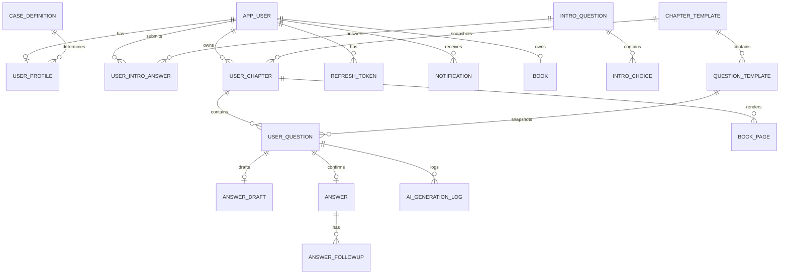

# Life Legacy 백엔드 기능 정의서

> 기준: 현재 `server/src` 코드  
> 보조 근거: `docs/api-spec.md`, `docs/server-architecture.md`, `erd/previous-erd.dbml`  
> 목적: 현재 NestJS 백엔드가 제공하는 기능과 데이터 구조를 제품 기능 단위로 정리한다.

> ⚠️ **이 문서는 As-Is다.** 목표 상태는 `erd/new-erd.dbml`(표 40개)과
> `docs/api-spec.md`의 `[변경]`·`[신규]` 표기에 있다.
> 화면별 요구사항은 [`screens/`](screens/) 참고.

## 1. 백엔드 개요

Life Legacy 백엔드는 사용자의 자기소개를 바탕으로 맞춤 목차를 만들고, 질문 답변을 AI가 꼬리질문·윤문하여 자서전으로 조립하는 API 서버다.

```text
Flutter 앱
  ↓ JSON /v1/*
NestJS Controller
  ↓
Service → Repository → PostgreSQL
  ↓
AI · SMS · Kakao 연동 지점
```

### 기술 구성

| 항목 | 현재 구성 |
|---|---|
| 런타임 | Node.js 24 |
| 프레임워크 | NestJS 11 |
| ORM | TypeORM |
| 데이터베이스 | PostgreSQL |
| 인증 | JWT access token + refresh token rotation |
| 문서 | Swagger `/docs` |
| 검증 | `ValidationPipe` |
| 응답 오류 | `{ code, message }` |
| 전역 프리픽스 | `/v1` (`/health` 제외) |

## 2. 기능 그룹

### A. 진입·인증·세션

사용자는 전화번호 인증 또는 카카오 로그인으로 가입과 로그인을 동시에 처리한다.

| API | 기능 |
|---|---|
| `POST /v1/auth/phone/code` | 인증번호 발송 요청 |
| `POST /v1/auth/phone/verify` | 인증번호 확인 및 세션 발급 |
| `POST /v1/auth/kakao` | 카카오 로그인 |
| `POST /v1/auth/refresh` | access token 갱신 및 refresh token 회전 |
| `POST /v1/auth/logout` | refresh token 폐기 |
| `GET /v1/users/me` | 내 정보 조회 |

현재 인증번호는 `482915` 고정 스텁이고, 카카오 토큰 검증도 스텁이다.

주요 정책:

- access token 유효기간은 1시간
- refresh token 유효기간은 60일
- refresh token은 SHA-256 해시만 저장
- 갱신할 때 기존 refresh token을 즉시 폐기
- 전화번호 인증번호는 5회 실패 시 폐기
- 인증번호 평문은 DB에 저장하지 않음

### B. 자기소개·케이스 판정·목차 생성

| API | 기능 |
|---|---|
| `GET /v1/intro/questions` | 자기소개 5문항 조회 |
| `POST /v1/intro/answers` | 답변 저장, 케이스 판정, 사용자별 목차 생성 |
| `POST /v1/intro/toc/confirm` | 사용자가 재배열한 목차 확정 |
| `GET /v1/intro/profile` | 자기소개 결과 조회 |

자기소개 답변에서 다음 3개 축을 계산한다.

```text
대학교 이상 여부 × 결혼 여부 × 자녀 여부 = 8개 케이스
```

목차 생성 시 공용 `chapter_template`, `question_template`을 사용자 소유의 `user_chapter`, `user_question`으로 복제한다. 이후 원본 카탈로그가 바뀌어도 이미 시작한 사용자의 질문은 바뀌지 않는다.

목차 확정 후:

- 1장만 `writing`
- 나머지는 `locked`
- 사용자가 정한 순서로 `sort_order` 재배치
- `intro_completed_at` 기록

### C. 장·질문 진행

| API | 기능 |
|---|---|
| `GET /v1/home` | 홈 요약과 전체 진행률 |
| `GET /v1/chapters` | 사용자별 장 목록 |
| `GET /v1/questions/current` | 현재 작성할 질문 |
| `GET /v1/questions/:id` | 질문 단건 조회 |
| `PATCH /v1/questions/:id` | 답변 전 질문 문구 수정 |

장 상태:

```text
locked → writing → done
```

- 한 사용자는 최대 한 개의 `writing` 장을 가진다.
- 장의 모든 질문이 `answered` 또는 `skipped`가 되면 `done` 처리한다.
- 다음 장 하나만 `writing`으로 연다.
- `locked` 장은 조회·답변 모두 거부한다.
- `done` 장은 v1에서 재작성하지 않는다.
- 현재 질문이 없으면 `204 No Content`로 전체 완료를 나타낸다.

### D. 답변·AI 처리

질문 하나의 답변은 두 단계로 처리한다.

```text
1차 답변
  → AI 꼬리질문 생성
  → 꼬리답변
  → AI 윤문
  → 원문·윤문 결과 확정 저장
  → 다음 질문
```

| API | 기능 |
|---|---|
| `POST /v1/questions/:id/answer` | 1차 답변 임시 저장 및 꼬리질문 생성 |
| `POST /v1/questions/:id/followup/:fid/answer` | 꼬리답변, 윤문, 확정 저장 |
| `POST /v1/questions/:id/skip` | 질문 건너뛰기 |

답변에 저장되는 정보:

- 1차 답변 원문
- 입력 방식: `voice` 또는 `keyboard`
- 음성 답변 시간
- AI 꼬리질문
- 꼬리답변 원문
- AI 윤문 결과
- 윤문 성공 여부와 시도 횟수

실패 정책:

| 실패 | 서버 동작 | 앱 동작 |
|---|---|---|
| 꼬리질문 생성 실패 | 1차 답변 draft 삭제 | 처음부터 다시 답변 |
| 윤문 실패 | draft 유지 | 저장만 재시도 |
| 중복 확정 요청 | 멱등 처리 | 기존 결과 유지 |

현재 `AiService`는 실제 AI 제공자가 아닌 고정 응답 스텁이다. 프롬프트 템플릿과 AI 호출 로그를 저장할 구조는 이미 존재한다.

### E. 자서전 결과물

| API | 기능 |
|---|---|
| `GET /v1/book` | 책 제목·작가·장·질문·페이지 요약 |
| `GET /v1/book/pages` | 완료된 장의 페이지별 본문 |

서버는 `done` 상태인 장만 모아 `polished_text`를 조립한다.

- 장이 완료되지 않았으면 본문에 포함하지 않음
- 서버가 페이지를 계산함
- 현재는 문단 3개 단위로 페이지를 나눔
- 앱은 서버가 준 페이지를 그대로 표시
- `book_page`는 현재 구현상 매 요청 계산 방식이며 캐시 확장 여지가 있음

현재 PDF 생성·다운로드, DOCX 생성, MP3 재생 파일 제공 API는 서버에 없다.

### F. 알림

| API | 기능 |
|---|---|
| `GET /v1/notifications` | 최신 알림 조회 |
| `POST /v1/notifications/read-all` | 전체 읽음 처리 |

알림은 오늘의 질문, 장 완료, 책 준비 등의 유형을 지원한다. `device_push_token` 테이블은 존재하지만 현재 알림 발송 provider/API는 구현 범위 밖이다.

### G. 설정·배송지

| API | 기능 |
|---|---|
| `GET /v1/settings` | 앱 설정 조회 |
| `PATCH /v1/settings` | 오늘의 질문 알림 설정 변경 |
| `GET /v1/shipping-address` | 배송지 조회 |
| `PUT /v1/shipping-address` | 배송지 저장 |

현재 설정은 `daily_question_alarm` 하나이며, 배송지는 인쇄본 주문을 위한 기본 정보로 저장한다.

## 3. 공통 서버 동작

### 요청 처리 순서

```text
AccessTokenGuard
  → ThrottlerGuard
  → ValidationPipe
  → Controller
  → Service
  → Transaction Service(필요 시)
  → Repository
  → Response DTO
```

### 공통 규칙

- DTO에 없는 요청 필드는 거부한다.
- Controller에는 비즈니스 로직을 두지 않는다.
- Repository는 쿼리만 담당한다.
- 여러 테이블을 함께 변경하는 작업은 트랜잭션으로 처리한다.
- 성공 단건 응답은 리소스 자체를 반환한다.
- 성공 목록 응답은 `{ items: [...] }`로 반환한다.
- 오류는 `{ code, message }`로 통일한다.
- `message`는 앱에 그대로 표시할 한국어 문장이다.

## 4. 데이터베이스 구조

PostgreSQL에 24개 테이블을 사용한다. 핵심은 **공용 원본 카탈로그를 사용자별 사본으로 복제하는 구조**다.

### 간단한 관계도



### 테이블 그룹

| 그룹 | 테이블 | 역할 |
|---|---|---|
| 사용자·인증 | `app_user`, `social_account`, `phone_verification`, `refresh_token`, `device_push_token` | 계정, 로그인, 세션, 푸시 토큰 |
| 자기소개 | `intro_question`, `intro_choice`, `user_intro_answer`, `case_definition`, `user_profile` | 원본 답변과 8개 케이스 판정 |
| 공용 카탈로그 | `chapter_template`, `question_template`, `prompt_template` | 장·질문·AI 프롬프트 원본 |
| 사용자 진행 | `user_chapter`, `user_question` | 사용자별 목차·질문 사본과 상태 |
| 답변 | `answer_draft`, `answer`, `answer_followup` | 임시 답변, 원문, 꼬리답변, 윤문 결과 |
| 결과물 | `book`, `book_page` | 책 요약과 서버 계산 페이지 |
| 부가 기능 | `notification`, `user_setting`, `shipping_address`, `ai_generation_log` | 알림, 설정, 배송지, AI 운영 로그 |

### 핵심 데이터 원칙

- 사용자별 본문은 `app_user`를 기준으로 소유권을 확인한다.
- 질문 원본은 `question_template`, 사용자가 실제 본 질문은 `user_question.text`에 저장한다.
- 답변 당시의 질문 문구도 `answer.question_text`에 다시 저장한다.
- 답변 원문과 AI 윤문 결과를 분리한다.
- AI 로그에는 민감한 프롬프트·응답 본문을 저장하지 않는다.
- 사용자 탈퇴를 고려해 `app_user.deleted_at` 소프트 삭제를 사용한다.
- 외래키 삭제 정책은 사용자 데이터에 `CASCADE`, 카탈로그 참조에는 주로 `SET NULL` 또는 `RESTRICT`를 사용한다.

## 5. 현재 구현 상태와 미구현 범위

### 현재 스텁

| 영역 | 현재 상태 |
|---|---|
| SMS | 고정 인증번호 `482915` |
| AI | 고정 꼬리질문·윤문 응답 |
| Kakao | 실제 토큰 검증 없음 |
| 푸시 알림 | 토큰 테이블만 존재 |

### 현재 API에 없는 기능

- PDF 생성·다운로드
- DOCX 생성·다운로드
- 이메일 발송
- MP3 업로드·저장·스트리밍 URL
- 사진 첨부
- 회원 탈퇴 API
- 인쇄 주문·결제
- 관리자 기능

### 기능 확장 시 권장 모듈

```text
server/src/book-export/
  book-export.controller.ts
  book-export.service.ts

server/src/mail/
  mail.module.ts
  mail.service.ts

server/src/media/
  media.controller.ts
  media.service.ts
```

PDF·메일은 NestJS에서 처리하고, Flutter는 다운로드·열기·재생 UI를 담당하는 방향이 적합하다.

## 6. 실행·환경 설정

```bash
cd server
npm install
npm run start:local
npm run seed
```

주요 환경변수:

```text
PORT
DB_HOST
DB_PORT
DB_USERNAME
DB_PASSWORD
DB_DATABASE
DB_SYNCHRONIZE
DB_POOL_MAX
JWT_ACCESS_SECRET
JWT_REFRESH_SECRET
SMS_PROVIDER
STUB_VERIFICATION_CODE
AI_PROVIDER
AI_MODEL
KAKAO_PROVIDER
SWAGGER_USER
```

DB 연결 기본값은 PostgreSQL `localhost:5432`이며, 실제 계정·DB명은 환경변수로 주입한다. 운영에서는 `DB_SYNCHRONIZE=false`로 두고 DDL을 수동 관리해야 한다.

현재 `server` 디렉터리에는 별도 migration, SQL, Docker Compose 설정이 없으므로 운영 스키마 변경은 코드 밖의 수동 DDL 또는 별도 배포 체계에 의존한다. 실제 비밀값 파일도 저장소에 포함되어 있지 않아 환경별 환경변수 또는 secret manager 주입이 필요하다.

## 7. 코드 기준 경로

| 영역 | 코드 경로 |
|---|---|
| 서버 부트스트랩 | `server/src/main.ts` |
| DB·모듈 등록 | `server/src/app.module.ts` |
| 인증 | `server/src/auth/` |
| 자기소개·케이스 | `server/src/intro/` |
| 장·질문 | `server/src/chapters/` |
| 답변·AI | `server/src/answers/`, `server/src/ai/` |
| 자서전 | `server/src/book/` |
| 알림 | `server/src/notifications/` |
| 설정 | `server/src/settings/` |
| 엔티티 전체 | `server/src/**/entities/*.entity.ts` |
| 상세 API 계약 | `docs/api-spec.md` |
| DBML ERD (현재) | `erd/previous-erd.dbml` |
| DBML ERD (목표) | `erd/new-erd.dbml` |
