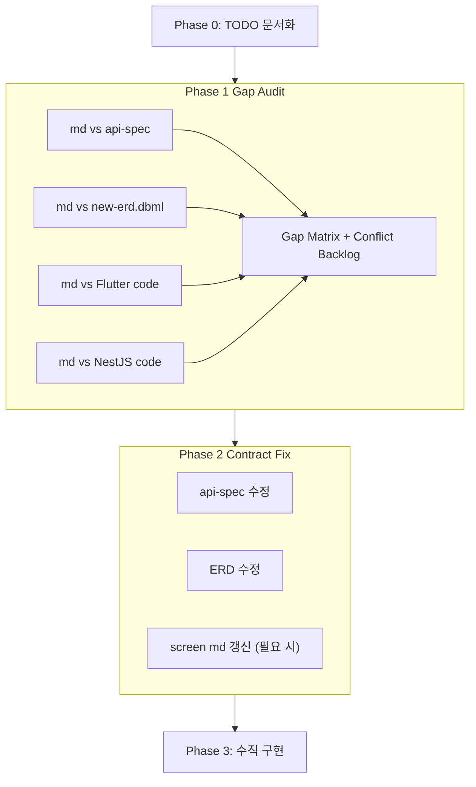

# 화면 MD 기준 정합화·순차 개발

**작성일**: 2026-08-04  
**목적**: 앱 화면 MD(`docs/screens/`)를 단일 기준으로 api-spec·ERD·Flutter·NestJS를 정합화하고 순차 구현  
**기준 우선순위**: 앱 화면 MD > api-spec = ERD > Flutter/NestJS 실제 코드

---

## Flow (전체 프로세스)

---

## Gap Matrix 템플릿

화면별로 아래 매트릭스를 만든다.

| 항목 | 화면 MD 요구사항 | api-spec | ERD | Flutter 코드 | NestJS 코드 | 판정 |
|------|-----------------|----------|-----|-------------|-------------|------|
| 기능·API·DB | md에 적힌 것 |  |  |  |  | 일치/수정/신규/미정 |

판정 코드: `OK` / `API수정` / `ERD수정` / `MD갱신` / `Flutter신규` / `Nest신규` / `정책대기`

---

## Phase 1 — Gap Audit 결과 (작성 예정)

### 01-landing.md

| 항목 | 화면 MD | api-spec | ERD | Flutter | NestJS | 판정 |
|------|---------|----------|-----|---------|--------|------|
| index 화면(세션 없음→시작하기) | 신규 화면, 버튼 1개, API없음, DB없음 | 해당없음 | 해당없음 | splash_view.dart 기존, 라우트·화면 없음 | 해당없음 | Flutter신규 |
| 세션 복원 후 분기 | 스플래시→세션 유무 → index/login | §1.4 refresh | - | `AuthService.restore()` 구현됨 | `/auth/refresh` 구현됨 | OK |
| 열린 이슈: 스플래시 설계 충돌 | "예전 시안엔 버튼 없던 랜딩" 주석 | - | - | `splash_view.dart` 9-11행 주석 | - | 정책대기 |

### 02-login-signup.md

| 항목 | 화면 MD | api-spec | ERD | Flutter | NestJS | 판정 |
|------|---------|----------|-----|---------|--------|------|
| 전화번호 입력 | 숫자 키패드, 하이픈 | - | - | `phone_view.dart` 구현됨 | - | OK |
| OCTOMO 챌린지 | `POST /auth/octomo/challenge` | §1.8 상세 명세 있음 | `auth_verification_session` 신규 | 미구현 | 미구현 | API수정(화면MD보다 명세 상세), Flutter신규, Nest신규 |
| OCTOMO verify 폴링 | `POST /auth/octomo/verify` | §1.9 상세 명세 있음 | `auth_verification_session` | 미구현 | 미구현 | API수정, Flutter신규, Nest신규 |
| 계정 식별 정책 | `(name, phone)` 복합 unique | §1.10 + ERD Note: 번호 단독 unique 유지 | `app_user.normalized_phone` 단독 unique | - | `app-user.entity.ts` phone 단독 | **MD갱신 필요** — 최신 결정이 번호 단독 유지, 화면 MD §6은 복합 unique 기술 |
| signup API | `POST /auth/signup` | §1.10 상세 명세 있음 | `app_user` + `user_consent` + `consent_document` | 미구현 | 미구현 | Flutter신규, Nest신규 |
| 약관 동의 화면 | 필수3+선택1 체크리스트, "동의하고 시작하기" | §1.10 `required_consents` 목록 응답 | `user_consent`, `consent_document` | 미구현 | 미구현 | Flutter신규, Nest신규 |
| 기존 OTP 유지 | 병행/교체 미정 | §1.1~1.2 기존, §15.4 확정 대기 | `phone_verification` 기존 | `code_view.dart` 구현됨 | `phone/code`, `phone/verify` 구현됨 | 정책대기 |
| 기존 Kakao | 스텁 | §1.3 기존 | `social_account` 기존 | `loginWithKakao()` 스텁 | `auth/kakao` 스텁 | 정책대기 |

### 03-intro.md

| 항목 | 화면 MD | api-spec | ERD | Flutter | NestJS | 판정 |
|------|---------|----------|-----|---------|--------|------|
| 성별 선택 | `남`/`여` (기존: `남성`/`여성`) | §2.1 `answer_type: choice`, choices에 `남`/`여` | `intro_answer_type` enum | `intro_view.dart` 5문항 고정 | `intro.controller.ts` 5문항 고정 | API변경, Flutter변경, Nest변경 |
| 생년월일 | 연/월/일 드롭다운 신규 | §2.1 `answer_type: date` | `intro_answer_type` enum | 미구현 | 미구현 | Flutter신규, Nest신규 |
| 결혼/자녀 건너뛰기 | `예`/`아니오`/건너뛰기 | §2.1 `skippable: true` | X | 미구현 | 미구현 | Flutter변경, Nest변경 |
| 학업 상세 | 단계→조건부 상세 | §2.1 `choices[].details` | X | 미구현 | 미구현 | Flutter신규, Nest신규 |
| 작성 계획 | `/v1/writing-plan` 또는 settings 확장 | §2.6 `GET/PUT /intro/writing-plan` 확정 | `writing_plan` 테이블 신규 | 미구현 | 미구현 | **MD갱신** — api-spec이 `/intro/writing-plan`으로 정리, ERD도 `writing_plan` table |
| 케이스 판정 | 기존 8케이스 유지 + 새 축 파생 | §2.2 | `user_profile`, `case_definition` | 기존 | `intro.service.ts`, `case-axes.ts` | OK (서비스 로직 변경) |
| `generateToc(Map<String, String>)` | 구조화된 입력으로 교체 필요 | §2.2 POST `/intro/answers` | - | `ApiClient.generateToc` | `intro.controller.ts` `POST intro/answers` | API변경, Flutter변경, Nest변경 |

### 03-1-intro-toc.md

| 항목 | 화면 MD | api-spec | ERD | Flutter | NestJS | 판정 |
|------|---------|----------|-----|---------|--------|------|
| 목차 표시·재정렬 | 기존 재사용 | - | `user_chapter` | `toc_view.dart`, `toc_controller.dart` | `intro-transaction.service.ts` | OK |
| 카탈로그 대목차 조회 | `GET /catalog/chapters` | §2.3 신규 | `chapter_template` | 미구현 | 미구현 | Flutter신규, Nest신규 |
| 목차 초안 편집 | `PATCH /intro/toc/draft` 제안 | §2.4 동일 | `user_chapter` source_type | 미구현 | 미구현 | Flutter신규, Nest신규 |
| 확정 시 `bookId` 반환 | 현재 204, bookId 필요 | §2.5 200 반환 변경 | `book` 테이블 | `confirmToc` void | `confirm-toc.dto.ts` → 변경 | API변경, Flutter변경, Nest변경 |
| 사용자 정의 장 source_type | `chapter_source` enum 필요 | §2.4 | `chapter_source` enum 신규 | `Chapter` 모델 확장 | `UserChapterModel` 확장 | Flutter변경, Nest변경 |

---

## 04-book-id-write.md (서브에이전트 감사 결과)

| 항목 | 화면 MD | api-spec | ERD | Flutter | NestJS | 판정 |
|------|---------|----------|-----|---------|--------|------|
| 다권 bookId route argument | bookId를 GetX arguments로 전달 | §0.6 `/books/{book_id}/…` 경로, 기존 단일 경로 전환기간 유지 | `book.id` PK, `owner_user_id` | `AppRoutes.write` 정적, arguments 미구현 | `AnswersController`에 bookId 미적용 | Flutter신규 |
| GET 현재 질문 (book 범위) | bookId 범위의 현재 소질문 조회 | §4.2 `GET /books/{book_id}/questions/current` 신규 | `user_chapter.book_id` → user_question | `currentQuestion()` bookId 미전달 | `ChaptersController` userId 기준, bookId 미지원 | Flutter신규, Nest신규 |
| 다권 POST 1차 답변 | 1차 원문 저장 후 꼬리질문 | §5.1 `POST /questions/{question_id}/answer` 기존 | `answer_draft` first_text 등 | `submitAnswer()` 구현 완료 | `AnswersController.submitAnswer()` 완료 | OK |
| 다권 POST 꼬리질문→확정 | 꼬리답변 윤문 확정 | §5.2 `POST .../followup/{fid}/answer` | `answer` + `answer_followup` | `submitFollowupAnswer()` 구현 완료 | `AnswersController.submitFollowupAnswer()` 완료 | OK |
| 3라운드 (최초+후속2회) | 반복 규칙 확장 필요 | §5.0 "전체 3라운드" | `answer_followup.seq` 최대 2행 | 1회만 가능 | `AnswersService`는 항상 확정, 중간 followup 응답 없음 | Nest신규 |
| 건너뛰기 | skipped 저장 후 다음 질문 | §5.5 `POST /questions/{id}/skip` | `user_question.status=skipped` | `skipQuestion()` 구현 완료 | `AnswersController.skip()` 완료 | OK |
| POST 초안 autosave | 전사 원문 draft autosave | §5.6 `PUT/GET/DELETE /questions/{id}/draft` 신규 | `answer_draft` recording_meta | `WriteController` draft 저장/복원 없음 | `AnswersRepository`에 draft 메서드만 있음, API 경로 없음 | Flutter신규, Nest신규 |
| TTS (질문 읽어주기) | TTS로 질문 읽고 글자 동기화 | §5.7 `POST /voice/tts`, 책 범위 불필요 | `media_asset` | `replayQuestion()` → 토스트만 | 서버 TTS 없음, `AiService` 스텁 | Flutter신규, Nest신규 |
| STT (음성→텍스트) | 단말 STT or 서버 Clova STT | §5.7 `POST /voice/stt` | `answer_draft.recording_meta` | `SpeechService` 단말 STT, 서버 STT 미구현 | 서버 STT 없음 | Nest신규 |
| 보이스/마이크 체크 | 최초 로드 시 체크, 타이핑 안내 | §5.8 `GET /voice/sample`, 책 범위 불필요 (api-spec 주석) | 해당없음 | `WriteController.startRecording()` 실패 시 토스트만 | 음성 점검 API 없음 | Flutter신규, Nest신규 |
| 튜토리얼 | 단계형 안내 회색 오버레이 | 확정 대기 §5.3 (저장 위치 미정) | 해당없음 | `showcaseview` pubspec, 튜토리얼 미구현 | 서버 튜토리얼 API 없음 | 정책대기 |
| 이탈 경고 | 미확정 draft 있을 때 나가기/취소 다이얼로그 | 명시적 엔드포인트 없음 | 해당없음 | `WriteController` 이탈 경고 없음 | 해당없음 | Flutter신규 |
| 챕터 완료 화면 | 리뷰 CTA + 홈 이동 | §5.9 `GET /books/{book_id}/chapters/{chapter_id}/completion` | `chapter_review` → `review_status=null` | `WriteView._AllDone` → `/book`만 | 미구현 | Flutter신규, Nest신규 |
| 다시 답하기/기존 답 추가 | 원문 삭제 또는 불러와 이어 입력 | §5.1 재호출, 전용 엔드포인트 없음 | `answer_draft` 덮어씀 | `WriteController` 재호출 로직 없음 | `submitFirstAnswer()` draft 덮어쓰기 완료 | Flutter신규 |
| write/session | 책 권한+질문+튜토리얼을 묶은 세션 | api-spec §5.9 주석: **별도 엔드포인트 미생성**. 기존 계약으로 분할 | 해당없음 | 미구현 | 미구현 | MD갱신 (화면 MD §5에서 제안 철회) |

## 06-book.md (서브에이전트 감사 결과)

| 항목 | 화면 MD | api-spec | ERD | Flutter | NestJS | 판정 |
|------|---------|----------|-----|---------|--------|------|
| 개인 책 목록 (1:N) | 사용자 1:N 책, 소유/참여 권한 있는 책 목록 | §6.1 `GET /books` 신규, `status`는 파생값 | `book.id` PK, `owner_user_id` | `BookView` 단일 책 장 목록, 책 목록 없음 | `BookController` 단일 책(userId 기준), 다권 API 없음 | Flutter신규, Nest신규 |
| 가로 슬라이딩 책 카드 | 제작 중/완료 섹션, 수평 스크롤 카드 | §6.1 응답의 `status`로 앱이 섹션 분리 | 해당없음 | `BookView` `ListView.separated` 세로 목록, 카드 없음 | 해당없음 | Flutter신규 |
| 책 상세 진입 | 카드 클릭 → `bookId` argument로 상세 이동 | §6.2 `GET /books/{book_id}` 신규 | `book.id`로 조회 | `AppRoutes`에 `bookDetail` 없음 | 다권 ID 기반 API 없음 | Flutter신규, Nest신규 |
| 책 생성 | 새 책/에디션 초안 생성, 기존 콘텐츠 초기화 금지 | §6.1 `POST /books` 신규 — 생성 방식 확정 대기 | `book.id` PK | 미구현 | 미구현 | Nest신규, 정책대기 |
| 이어쓰기 (bookId 전달) | 선택한 bookId를 write 화면에 전달 | §0.6 책 범위 경로 | `user_chapter.book_id` | `continueWriting()` → bookId 미전달 | `ChaptersService` userId 기준, bookId 미지원 | Flutter신규, Nest신규 |
| 제작 상태 분류 | 서버 반환 상태 기준 섹션화 | §6.1 `status` 파생: draft/writing/completed (기존 `is_complete`≠) | `book`에 status 컬럼 없음 (파생) | `Book.isComplete` Boolean만 | `is_complete` = 모든 장 `DONE`. **`reviewed`가 아니라 `done`** | Nest신규, MD갱신 |
| 하단 사용자/진행 요약 | 표시 이름, 제작 중/완료 책 수 | 확정 대기 | `app_user.name` | 미구현 | `GET /users/me`에 책 수 집계 없음 | 정책대기 |
| GET /books (목록) | 소유 책 목록 반환 | §6.1 신규 | `book.owner_user_id` 필터 | `ApiClient`에 `books()` 없음 | 없음 | Flutter신규, Nest신규 |
| GET /book (기존 단일) | v1 호환 — 첫 책 해석 | §6.3 기존, 전환기간 유지 | v1 `book.user_id` PK | `book()` → `GET /book`, OK | `BookController.getBook()` 완료 | OK |
| GET /books/{id}/chapters | 선택한 책 범위 장 목록 | §4.1 신규, `GET /chapters` 전환기간 유지 | `user_chapter.book_id` 조회 | `chapters()` → bookId 미전달 | `ChaptersController` userId 기준 | Flutter신규, Nest신규 |
| GET /books/{id}/pages | 선택한 책 미리보기 페이지 | §6.4 변경, `GET /book/pages` 전환기간 유지 | `book_page.book_id` | `bookPages()` → 단일 책 | 단일 책 userId 기준 | Flutter신규, Nest신규 |
| 데이터 이전 (v1→다권) | 기존 사용자 첫 book backfill, 유니크 전환 | ERD 마이그레이션 노트 7단계 | `owner_user_id` backfill | 해당없음 | 마이그레이션 스크립트 없음 | Nest신규 |

## 06-1-book-id.md (서브에이전트 감사 결과)

| 항목 | 화면 MD | api-spec | ERD | Flutter | NestJS | 판정 |
|------|---------|----------|-----|---------|--------|------|
| 에디션 상세 허브 | bookId 범위 진행·후처리·권한 묶어 표시 | §6.2 `GET /books/{book_id}` dashboard | `book.id` → `user_chapter`+`chapter_review`+`user_entitlement` | `BookView` 단일 책 장 목록, 상세 허브 없음 | 다권 book 상세 API 없음 | Flutter신규, Nest신규 |
| 현재 Question 카드 | Question + 답변하러 가기 + X | §6.2 `current_question`, §4.2 `GET.../questions/current` | `user_chapter.book_id` 귀속 | 미구현 | 미구현 | Flutter신규, Nest신규 |
| 목차별 진행·리뷰 상태 | 장별 답변 수, 리뷰 완료, ebook 자격 | §6.2 `chapters[].{review_status, ebook_eligible}` | `chapter_review.status` = reviewed가 ebook 자격 | `Chapter` 모델에 `reviewStatus`/`ebookEligible` 없음 | `ChapterResponseDto`에 reviewStatus 없음 | Flutter신규, Nest신규 |
| 길 이정표 진행 뷰 | 버튼형 이정표 → 상세 진행 화면 | api-spec §6.2 주석: **두지 않음** (Figma 시안 미확인) | 해당없음 | 미구현 | 미구현 | 정책대기 (MD갱신 - 화면06-1에 제안 철회 반영) |
| 전자책 미리보기 | 완료+리뷰 완료 챕터 페이지 | §6.4 `GET /books/{id}/pages`, §10.1 eligibility | `chapter_review.status=reviewed`가 자격 | `bookPages()` → 단일 책, OK | `BookService.getPages()` done 장만. 리뷰 상태 미적용 | Nest신규 |
| 음성책 관리 | 잠금/업그레이드 안내 | §10.4 오디오북 API 9종 신규 | `audiobook_job` 등 | 없음 | 없음 | Flutter신규, Nest신규 |
| AI 영상 그림책 관리 | 잠금/업그레이드 안내 | 앱 비범위 (api-spec §15.2) | `storybook_job` 웹 전용 | 앱 비범위 | 앱 비범위 | MD갱신 (화면06-1에 앱 비범위 명시) |
| 플랜 잠금 (entitlement) | 기능별 서버 entitlement 판정 | §11 `GET /books/{id}/entitlements` 신규 | `user_entitlement`, `entitlement_ledger` | 미구현 | 미구현 | Flutter신규, Nest신규 |
| 팩트 체크 | 후보 추출→확인→Question 전환 | v1 범위 제외, 향후 TODO | 없음 (확정 대기) | 미구현 | 미구현 | 정책대기 |
| 인앱 알림 목록 | 홈 드롭다운/알림 센터 조회+모두읽음 | §7 기존, `book_id` 범위 신규 | `notification.book_id` 신규 | `notifications()` + `markAllNotificationsRead()` OK | `GET/POST /notifications` 완료 | OK (기존), Flutter신규(딥링크) |
| 푸시 알림 | device_push_token 등록, FCM/APNs 발송 | §7.3 `POST /device-push-tokens` 신규, 발송 경로는 확정 대기 | `device_push_token` 변경 | 미구현 | 엔티티만 존재 | Nest신규, 정책대기 |
| 일정 알림 | daily_question_alarm + 시간대 | §8.1 `GET/PATCH /settings` Boolean만, 발송 시각 확정 대기 | `user_setting.daily_question_alarm` | `settings()` + `updateSettings()` OK | GET/PATCH /settings 완료 | 정책대기 |
| questionId 전달 | CTA → `arguments: {bookId, questionId}` | §4.2 응답에 `id` 포함 | `user_question.id` | `AppRoutes.write` 정적, questionId 미구현 | GET /questions/{id} 기존 | Flutter신규 |
| POST /device-push-tokens | 단말 토큰 등록/교체/폐기 | §7.3 신규 | `device_push_token` upsert | 미구현 | 미구현 | Nest신규 |
| `review_status` in 장 응답 | 장 완료+리뷰 완료 여부 | §6.2 `chapters[].review_status` | `chapter_review` 테이블 | `Chapter` 모델에 `reviewStatus` 없음 | `ChapterResponseDto` 없음 | Flutter신규, Nest신규 |

## 05-book-id-review.md (서브에이전트 감사 결과)

| 항목 | 화면 MD | api-spec | ERD | Flutter | NestJS | 판정 |
|------|---------|----------|-----|---------|--------|------|
| 종합 원고 조회 | GET review (author + chapter + permissions) | §9.1 GET /books/{id}/chapters/{id}/review | chapter_review (신규) | 없음 (review route/controller/view 없음) | 없음 (review module 없음) | Flutter신규, Nest신규 |
| 종합 원고 생성 | POST synthesize (답변→AI 원고) | §9.2 POST synthesize (timeout 90s) | chapter_review.ai_draft, body | 없음 | 없음 (ai_task_kind=synthesize 미구현) | Flutter신규, Nest신규 |
| 리뷰 저장 (앱 읽기전용) | PATCH review (body 미전송) | §9.3 PATCH, version conflict → 409 | chapter_review.status=draft→reviewed | 없음 | 없음 | Flutter신규, Nest신규 |
| 저장 완료 문구 | "챕터1 저장 완료" / "현재 챕터 저장 완료" | §9.3 message, next_chapter_id | 서비스 로직 | 없음 | 없음 | Flutter신규, Nest신규 |
| Naver Voice TTS (청킹) | POST tts (청크 단위 순차 재생) | §9.4 POST tts, chunk_size | media_asset (신규) | 없음 (AppMicButton만, TTS player 없음) | 없음 | Flutter신규, Nest신규 |
| AI 사진 생성·조회 | POST images/generate, placement 순서 표시 | §9.5 images/generate, §9.1 media[].paragraph_index | media_asset, media_placement (신규) | 없음 | 없음 | Flutter신규, Nest신규 |
| 플랜 권한 (무료/유료) | 서버 검증, UI 보조 | §9.1 permissions | user_entitlement (신규) | 없음 | 없음 | Flutter신규, Nest신규 |
| 웹 수정 안내 | "웹에서 수정할 수 있어요" | §9.1 edit_hint, PATCH가 body를 받지 않음 | - | 없음 | - | Flutter신규 |
| AI와 함께 수정하기 | TODO/검토 (voice-rewrite) | §9 확정대기, 엔드포인트 미작성 | ERD 미반영 | 없음 | 없음 | 정책대기 |
| AI 사진 1장 만들기 | TODO but 출시 전 필수 | §9.5 이미지 생성 (동의 선행 필수) | media_asset.source=ai_generated | 없음 | 없음 | 정책대기 |

## 06-1-1-book-id-ebook.md (서브에이전트 감사 결과)

| 항목 | 화면 MD | api-spec | ERD | Flutter | NestJS | 판정 |
|------|---------|----------|-----|---------|--------|------|
| ebook 자격 조회 | GET eligibility (챕터1 reviewed 판정) | §10.1 GET /books/{id}/ebook/eligibility | chapter_review.status, user_entitlement | 없음 | 없음 | Flutter신규, Nest신규 |
| 인클루드 범위 | **챕터1만 부분 ebook** (초기 제안) | **reviewed 장 전부** (§10.1 + 결정기록 08-03) | ebook_export "담기는 것은 reviewed 장 전부" | 없음 | 없음 | **MD갱신** |
| PDF 생성 | POST generate (기본 표지+허용 원고) | §10.2 POST /books/{id}/ebook/generate | ebook_export (신규) | 없음 (preview_view는 비PDF 텍스트) | 없음 (GET /v1/book/pages만) | Flutter신규, Nest신규 |
| PDF 파일 제공·다운로드 | GET file, 다운로드·공유 | §10.2 GET /books/{id}/ebook/file | media_asset (신규) | PDF viewer 패키지 없음 (pubspec) | 없음 | Flutter신규, Nest신규 |
| 기본 표지 | 서비스 기본 표지+제목/저자 기본값 | §10.1 cover_kind="default" | ebook_export.cover_kind | 없음 | 없음 | Flutter신규, Nest신규 |
| AI 제목 추천 | POST titles/suggest (진행률 80% 조건) | §10.3 POST titles/suggest (미달 시 403) | book.title | 없음 | 없음 | Flutter신규, Nest신규 |
| 제목 저장 | PATCH metadata | §10.3 PATCH /books/{id}/ebook/metadata | - | 없음 | 없음 | Flutter신규, Nest신규 |
| 앱 표지 제작/편집 | TODO (이 화면에서 제공하지 않음) | 언급 없음 | - | - | - | 정책대기 |

## 06-1-2-book-id-audiobook.md (서브에이전트 감사 결과)

| 항목 | 화면 MD | api-spec | ERD | Flutter | NestJS | 판정 |
|------|---------|----------|-----|---------|--------|------|
| 오디오북 상태 조회 | GET audiobook (목차별 상태·잔여 횟수) | §10.4 GET /books/{id}/audiobook | audiobook_job, user_entitlement | 없음 | 없음 | Flutter신규, Nest신규 |
| Voice 선택·미리듣기 | GET voices, POST voice-preview | §10.4 동일 | voice_code (audiobook_job) | 없음 | 없음 | Flutter신규, Nest신규 |
| BGM 선택 | GET bgms, 선택/끄기 | §10.4 GET bgms | bgm_track (신규) | 없음 | 없음 | Flutter신규, Nest신규 |
| 챕터별 생성 job | POST jobs / GET jobs/:id / POST cancel | §10.4 동일 3개 엔드포인트 | audiobook_job, audiobook_job_part | 없음 | 없음 | Flutter신규, Nest신규 |
| 재생 | GET stream (인증된 stream) | §10.4 GET /chapters/{id}/stream | media_asset (신규) | audio player 패키지 없음 | 없음 | Flutter신규, Nest신규 |
| 다운로드 | POST downloads (한도 원자 차감) | §10.4 POST /chapters/{id}/downloads | entitlement_ledger (신규) | 없음 | 없음 | Flutter신규, Nest신규 |
| 유료 플랜 잠금 | 무료는 접근 불가·안내만 | allowed=false, reason="PLAN_REQUIRED" | user_entitlement | 없음 | 없음 | Flutter신규, Nest신규 |
| 2회 생성 한도 | 챕터별 2회 (초기 제안) | remaining_generations → 결정기록 "생성 2회/챕터, 재생·다운로드 무제한" | entitlement_ledger | 없음 | 없음 | Flutter신규, Nest신규, MD갱신 |

## 06-1-3-book-id-storybook.md (서브에이전트 감사 결과)

| 항목 | 화면 MD | api-spec | ERD | Flutter | NestJS | 판정 |
|------|---------|----------|-----|---------|--------|------|
| 앱 비범위 | Flutter 화면/CTA/재생을 구현하지 않음 | §15.2 "앱 비범위. 웹 전용 후처리" | storybook_job note "웹 전용" | app_routes에 storybook 없음 (일관됨) | - | OK |

## 07-09-qna-faq-settings.md (서브에이전트 감사 결과)

| 항목 | 화면 MD | api-spec | ERD | Flutter | NestJS | 판정 |
|------|---------|----------|-----|---------|--------|------|
| QnA 문의 등록 | POST /qna | §12 POST /qna | qna_question (신규) | 없음 | 없음 | Flutter신규, Nest신규 |
| QnA 내 문의 조회 | GET /qna/me | §12 GET /qna/me | qna_question (신규) | 없음 | 없음 | Flutter신규, Nest신규 |
| QnA 공개 게시 조회 | GET /qna/published | §12 GET /qna/published | qna_question (신규) | 없음 | 없음 | Flutter신규, Nest신규 |
| FAQ 조회 | 정적 콘텐츠 또는 읽기 전용 API | §12 "API를 만들지 않음, 앱 번들 정적 콘텐츠" | FAQ 테이블 없음 (의도적) | 없음 | 없음 | Flutter신규 (정적 번들링) |
| 약관 문서 라우트 | "준비 중" 토스트 | §1.11 GET /consents/documents | consent_document (신규) | 토스트만 | 없음 | Flutter신규, Nest신규 |
| 회원 탈퇴 | API·UI·보존/파기 없음 | §1.12 DELETE /users/me | app_user.deleted_at | 없음 | 없음 | Flutter신규, Nest신규 |
| 설정·프로필 조회 | 기존 (이름·전화번호·배송지 읽기 전용) | - | app_user (기존) | profile_view.dart, controller 존재 | settings.controller, service 존재 | OK |
| 배송지 조회·저장 | 기존 | - | shipping_address (기존) | address_view.dart 존재 | settings.controller 존재 | OK |
| 오늘의 질문 알림 | 기존 토글 | - | user_setting (기존) | settings_view.dart 존재 | settings.controller 존재 | OK |
| 로그아웃 | 기존 | - | refresh_token | settings_view.dart 존재 | POST /auth/logout 존재 | OK |
| 우편번호 검색 | "준비 중" 토스트 | - | - | address_view.dart (부분) | - | 정책대기 |
| 프로필 수정 | 신규 (현재 조회 전용) | 언급 없음 | user_profile | 없음 | 없음 | 정책대기 |

---

## Conflict Backlog (Phase 1 종합)

### 충돌·미결 목록

| # | 영역 | 상세 | 우선순위 | 결정 필요 |
|---|------|------|----------|---------|
| 1 | 계정 unique | 화면02: `(name, phone)` / ERD+api-spec: 번호 단독 | 상 | 화면 MD 02 §6 갱신 필요 |
| 2 | Writing plan | 화면03: settings 확장 또는 별도 / api-spec: `/intro/writing-plan` | 상 | 화면 MD 03 §5 갱신 (api-spec 따름) |
| 3 | auth/phone/code·verify 존치 | 화면02: OCTOMO 전환 명시 / 기존 OTP 스텁 병행 | 상 | 정책대기(§15.4 §1) |
| 4 | `book.id` 전환 | 화면06·06-1: `bookId` 필요 / 코드: `user_id`가 PK | 중대 | ERD·api-spec은 전환 완료, 코드는 미구현 |
| 5 | write/session·voice/check | 화면04 제안 / api-spec: 제외 (책 범위 불필요) | 중 | 화면 MD 04 §5 갱신 (api-spec 주석 따름) |
| 6 | 책 진행 `GET /books/:id/progress` | 화면06-1 제안 / api-spec §6.2: 제외 (chapters[]로 충분) | 중 | 화면 MD 06-1 갱신 |
| 7 | audiobook 한도 | 화면06-1-2: 제공/다운로드 2회 / 결정기록: 생성 2회·재생·다운로드 무제한 | 중 | 화면 MD 06-1-2 갱신 |
| 8 | storybook 앱 비범위 | 화면06-1-3·06-1: 앱 비범위 명시 / api-spec §15.2 일치 | 하 | OK (일치 확인) |
| 9 | ebook 범위 | 화면06-1-1: 챕터1만 부분 / 결정기록: reviewed 장 전부 | 중 | 화면 MD 06-1-1 갱신 |
| 10 | title suggest with progress | 화면06-1-1: 80% 조건 / api-spec §10.3: 403 미달 시 | 중 | OK (일치) |
| 11 | `DailyQuestionAlarm` 확장 | 화면03: 알림 시간·스케줄 / api-spec: Boolean만 | 중 | 정책대기 |
| 12 | 튜토리얼 저장 위치 | 화면04: 로컬 vs 서버 / api-spec: 미정 (§5 확정 대기) | 중 | 정책대기 |
| 13 | 3라운드 꼬리질문 | 화면04: 1회→확장 / api-spec §5.0 전체 3라운드 / NestJS: 항상 확정 | 중 | Nest신규 (중간 followup 응답 필요) |
| 14 | write/session 제안 | 화면04: 세션 API 제안 / api-spec: 기존 계약 분할, 별도 엔드포인트 없음 | 중 | 화면 MD 04 §5 갱신 |
| 15 | 제작 상태 = completed 기준 | 화면06: "제작 완료" 정의 미정 / api-spec §6.1: 모든 장 `reviewed` / 코드: `done` | 중 | 화면 MD 06 갱신 (api-spec 따름) |
| 16 | review 모듈 완전 신규 | 화면05: 챕터 종합·TTS·사진 신규 / api-spec §9 전부 신규 | 중대 | Flutter+NestJS 전면 신규 |

### 구현 착수 전 필수 해결 항목

위 목록 중 다음은 **Flutter/NestJS 코드를 바꾸기 전에 계약이 먼저 확정되어야 한다**:

| 우선순위 | 항목 | 비고 |
|----------|------|------|
| P0 | 인증 계약 (OCTOMO + signup) | #1 계정 unique 갱신 (#2 writing plan 위치), OCTOMO 폴링/챌린지, signup API, consent |
| P0 | 다권 `book` / `book_id` 구조 | #4 ERD는 준비, `book` 마이그레이션 계획 필요, `user_chapter.book_id` backfill |
| P0 | intro `answers` / `generateToc` 교체 | Map<String,String> → 구조화된 입력 |
| P0 | 목차 편집 `draft` + `confirm` 응답 | `bookId` 반환, `chapter_source` |
| P1 | 작성 화면 `bookId` 전달 | GetX arguments, API 경로 전환 |
| P1 | 챕터 완료 + review 상태 모델 | `done` ≠ `reviewed`, `chapter_review` 도입 |
| P1 | 꼬리질문 3라운드 | 서버 응답 분기 필요 |
| P1 | 언어 음성 점검 | api-spec §5.8 책 범위 불필요 결정 |
| P2 | review 모듈 (원고·TTS·사진) | 화면05 전면 신규 |
| P2 | ebook 범위 결정 | 화면06-1-1 MD 갱신 (reviewed 장 전부) |
| P2 | audiobook 한도 정책 | 화면06-1-2 MD 갱신 (생성 2회) |
| P2 | QnA·FAQ·탈퇴 | 인증·계약 확정 후 구현

---

## Phase 3 — 구현 순서

| 순서 | 화면 | Flutter | NestJS | DB migration |
|------|------|---------|--------|-------------|
| 0 | 계약 확정 (Phase 2) | - | api-spec·ERD 정합 | backfill plan |
| 1 | 01 landing | `feature/index/` 신규, splash 분기 | 없음 | 없음 |
| 2 | 02 auth | OCTOMO UI·signup·약관 | OCTOMO adapter·signup API | `auth_verification_session`, `user_consent` |
| 3 | 03 intro | 다단계 인트로 개편 | 질문/답변/케이스 확장 | `writing_plan` |
| 4 | 03-1 toc | 편집·추가 UI | `catalog/chapters`, `toc/draft`, `confirm` 변경 | `chapter_source` |
| 5 | 04 write | `bookId` 전달·튜토리얼·다시답하기 | 다권 질문/답변 API | `book_id` backfill |
| 6 | 06 book hub | 책 목록·카드·허브 개편 | `GET /books`, `POST /books` | `book` 마이그레이션 |
| 7 | 06-1 book detail | 상세·Question 카드·진행 | `dashboard`, entitlement | `book_id` 범위 API |
| 8 | 05 review | 원고·TTS·사진 조회 | `chapter_review`, synthesize | `chapter_review`, `media_asset` |
| 9 | 06-1-1 ebook | PDF viewer·다운로드 | `ebook/*` 권한·생성 | `ebook_export` |
| 10 | 06-1-2 audiobook | 재생·생성 UI | `audiobook/*` job API | `audiobook_job` 등 |
| 11 | 07-09 support | QnA·FAQ·설정 잔여 | `qna/*` API | `qna_question` |

스토리북(06-1-3)은 앱 비범위. NestJS 공통 API만 필요하면 마지막.

---

## 참고

- api-spec §15.3: 오늘 결정 12건 기록
- api-spec §15.4: 절별 확정 대기 색인
- `erd/new-erd.dbml`: To-Be 스키마 (1196라인)
- `erd/previous-erd.dbml`: As-Is 스키마
